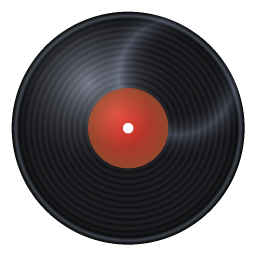
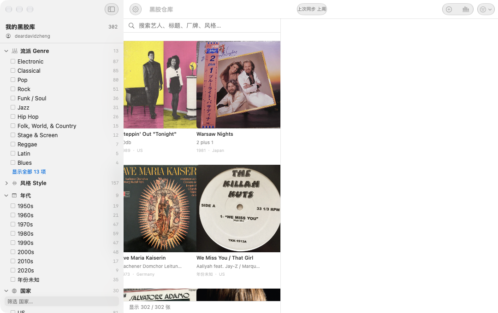
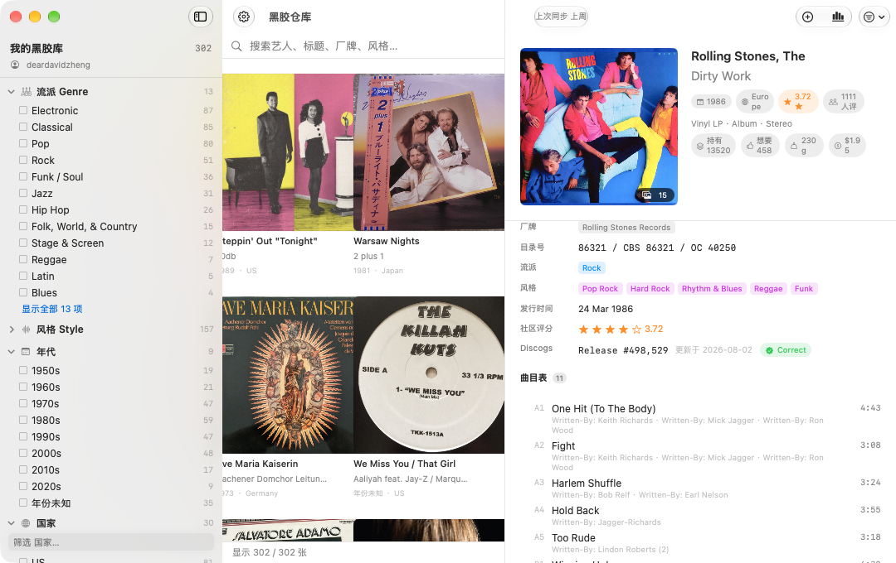
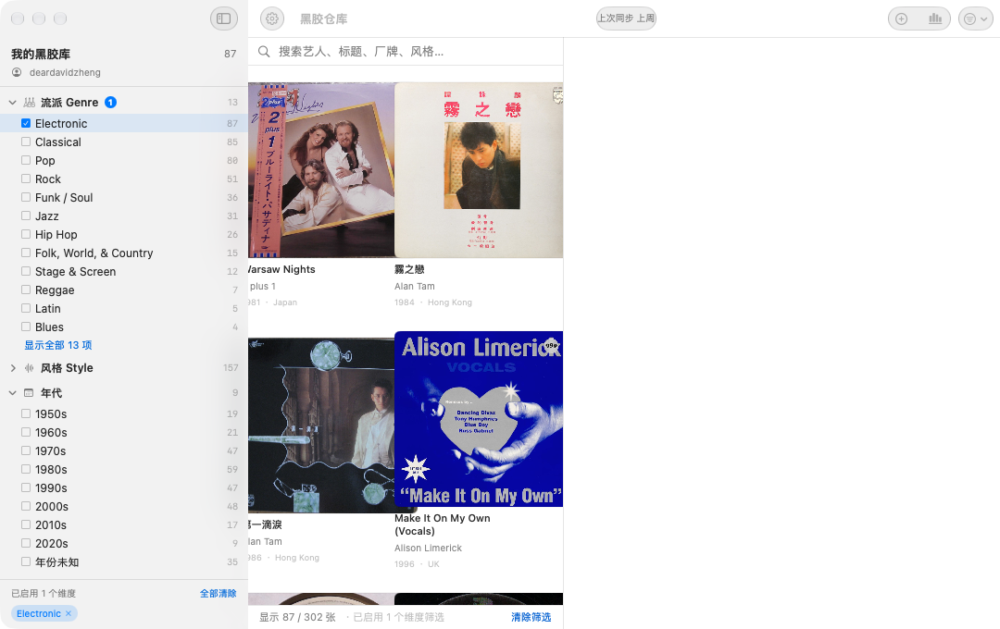
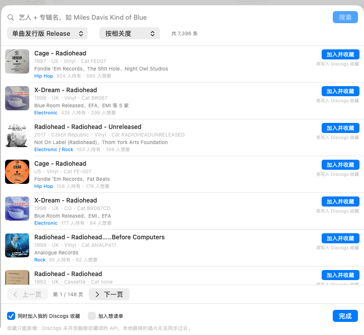

# VinylShelf · 黑胶仓库

本地黑胶唱片收藏管理应用，对接 [Discogs](https://www.discogs.com) 数据库。

[](https://www.apple.com/macos/)
[](https://www.swift.org/)
[](LICENSE)
[](build.sh)
[](https://github.com/deardavidzheng/VinylShelf/releases)





## 特性

- **完整资料**：不只年份/流派，而是把 Discogs 上这条 release 的**全部可用信息**抓下来存本地
  —— 曲目表（含时长与逐曲制作人员）、制作人员名录、参与公司（录于/版权/母版/压片厂）、
  编号体系（Barcode / Matrix Number / Label Code）、全部图片、系列、备注、社区评分。
  同时**完整留存 Discogs 原始 JSON**，将来模型升级可回溯重放，不会丢字段。
- **多维检索**：11 个维度 facet 侧栏多选——流派、风格、年代、国家、艺人、厂牌、规格、
  品相、收藏状态、自定义标签、Discogs 文件夹。**维度内多选是「或」（并集）**，
  跨维度是「且」（相交）。
- **标签列表恒定**：侧栏计数恒为**全库口径**，不会因为选了某个标签就塌缩——
  选中「Electronic」之后，Classical / Pop / Rock 依然都在。详见下方设计说明。
- **增量同步**：只拉真正变化过的条目（见下方原理）。
- **搜索添加**：在 Discogs 数据库搜关键词（Release / Master 两种范围、6 种排序、
  50 条一页可翻页），添加本地没有的唱片，自动补齐完整资料并把**全部图片**下载到本地。
  结果里直接标出「已在本地」「已在 Discogs 收藏」，并显示持有/想要人数；
  厂牌去重后取前几家（搜索返回的 label 前几个常是发行商）。
- **加入收藏**：添加时可勾选「同时加入我的 Discogs 收藏」，一次操作完成本地入库 +
  写入线上收藏；也可事后在设置页批量推送所有待同步条目。
- **写回 Discogs**：可把本地新增的唱片推送到 Discogs 收藏；可导入 Discogs 想读单。
- **本地字段**：我的评分、品相、存放位置、自定义标签、笔记、收藏状态——这些只存本地，
  Discogs 同步回来时**不会覆盖**它们。
- **离线可用**：SQLite 本地库 + 封面磁盘缓存。

## 界面

**完整资料**——不是只存年份和流派。下面这条是 Rolling Stones《Dirty Work》，
每一首曲目都带各自的制作人员，整张唱片的编号体系、参与公司、社区数据一并落库：



**标签列表恒定**——选中「Electronic」之后，流派列表里 Classical / Pop / Rock
**一个都没少**，只有中栏结果变成 87 张。这是最容易做错的一处设计，
展开讲见[「侧栏 facet 的两条设计决定」](#侧栏-facet-的两条设计决定)。



**搜索并添加**——直接在 Discogs 数据库搜，结果标注持有/想要人数与是否已在本地，
可一次完成「本地入库 + 写入 Discogs 收藏」：



## 快速开始

不想自己编译的话，去
[**Releases**](https://github.com/deardavidzheng/VinylShelf/releases) 下载 `VinylShelf-1.0.0.dmg`
（**Universal**，Apple Silicon 与 Intel 通用），拖进「应用程序」即可。

自己编译（需要 Xcode 命令行工具）：

```bash
./build.sh          # 编译 arm64 + x86_64 → lipo 合成 Universal → 签名 → DMG
open build/VinylShelf.app
```

> `./build.sh` 会分别编译两个架构再 `lipo` 合成，并对结果做架构断言。
> 直接给 `swiftc` 传一个 fat target 也行，但某个架构编不过时只能拿到一个残废包，
> 分开编能立刻看出是哪一边的问题。

首次使用：

1. 打开 **设置**
2. 粘贴 **Discogs Personal Access Token**
   - 获取：登录 discogs.com → Settings → Developers → Personal Access Tokens → Generate new token
   - 注意：Discogs 已停用账号密码直接连接（password grant 已移除），只能用 token
3. 点 **立即同步**，导入你的收藏

Token 存进 `~/Library/Application Support/VinylShelf/discogs_token.secret`（权限 600）。

> 为什么不用 Keychain：Keychain 项的 ACL 绑定写入者二进制，每次重新编译后哈希都变，
> 于是每次读都会弹系统授权框。文件存储在 App 私有目录，权限 600，效果相同且不打扰。

## 增量同步原理

Discogs 的 collection 接口**只返回 `date_added`，不返回"最后更新时间"**
（实测每一条都没有 `date_changed`），所以无法用时间戳做增量判断。

本 App 的做法是**字段指纹**：

| 阶段 | 动作 | 请求数（302 张实测） |
|------|------|------------------|
| 1. collection | 分页拉列表，计算每条的字段指纹，与本地持久化的指纹比对 | 4（`per_page=100`，302 条 → 4 页） |
| 2. detail | **只对指纹变化或从未拉过详情的条目**请求 `/releases/{id}` | 0（无变化时） |

- 本地新增、线上删除：自动识别
- 指纹未变：完全跳过，不发请求
- 首次导入 300 张量级约 5.5 分钟（受 60 req/min 限流约束）
- 日常无变化的同步：**8 个请求 / 5.8 秒**（`VINYLSHELF_TRACE=1` 实测：4 次 collection
  分页 + 2 次详情补齐 + `/oauth/identity` + collection 文件夹列表）

> ⚠️ 实现要点：指纹必须用**稳定哈希**（FNV-1a），不能用 Swift 的 `String.hashValue`
> ——后者带进程级随机种子，跨进程永不相等，会让增量在每次重启后退化成全量重拉。
> 见 `Sources/Core/StableHash.swift`。

## 数据完整性（302 张，2026-10-16 实测）

```
总记录        302      完整详情      302
有国家        301      有曲目表      302
有图集        300      有原始 JSON   302
有编号体系    228      有制作人员    226
有参与公司    190      facet 索引  4428 条
```

年份跨度 1951–2023，`country` 覆盖 301/302。11 个维度的 facet 索引逐条与真值一致
（`/tmp/Harness <token> verify` 输出 `✓ facet 索引一致`）。

`country` 只能从 `/releases/{id}` 拿到——collection 接口实测一条都不提供该字段。

## 侧栏 facet 的两条设计决定

**1. 计数恒为全库口径，不做 drill-down。**

最初的实现是 `facetCounts(restrictIds: 当前筛选结果)`，也就是每个维度的计数只统计
「当前筛选命中的记录」。结果选中「Electronic」后，整个标签宇宙会塌缩成该子集里
实际出现过的值——表现为流派从 13 个缩到 10 个、国家少掉 18 个、厂牌少掉 139 个，
看起来就像「该维度不支持多选」。

现在 `AppState.recomputeFacets()` 传 `restrictIds: nil`，**筛选只影响中间栏结果，
永不影响标签列表本身**。`Tests/Harness.swift` 的 `facetstable` 命令把这条钉成了断言：
逐维度比对「facet 计数」与「直接从 records 现算的真值」，必须逐值逐计数相等。

**2. 覆盖全部 11 个维度，不挑几个。**

曾经硬编码只查 6 个维度，于是艺人（428 个取值）、品相、收藏状态、文件夹、
自定义标签在侧栏里全是空白——数据在库里，只是没去查。

另外两个相关的小坑：
- `FacetDimension.values(of:)` 的返回值必须先 `dedupe()`。Discogs 的 `formats`
  展平后是 `["Vinyl","LP","Vinyl","LP"]`（同一次发行既有 Vinyl 面又有 LP），
  合作发行里同一厂牌/艺人也会出现多次。不去重的话详情页会把「Mo Wax」显示两遍。
- 任何**绕过 `Database.delete(id:)`** 的 `DELETE FROM records` 都会在 `facets` 表
  留下孤儿行，让每个标签的计数凭空 +1。`deleteOrphanFacets()` 是兜底。

## 与 Discogs 的同步边界（实测，非文档推断）

| 方向 | 能力 | 端点 |
|------|------|------|
| Discogs → 本地 | ✅ 完整 | collection 分页 + `/releases/{id}` |
| 本地 → Discogs 收藏 | ✅ 可加 | `POST .../collection/folders/{f}/releases/{id}` |
| 本地 → 删除 Discogs 收藏 | ❌ **不可能** | 该端点 `Allow: POST`，DELETE/PUT/PATCH 一律 405 |
| 本地 → Discogs 评分/备注 | ❌ 无端点 | 仍属纯本地字段 |
| Discogs wantlist → 本地 | ⚠️ 见下 | `GET /users/{u}/wantlist` |

两个必须知道的实测结果：

1. **Discogs 根本没开放「删除收藏项」的 API。** 对
   `/users/{u}/collection/folders/{f}/releases/{id}` 发 OPTIONS，返回
   `405` + `Allow: POST`。所以双向同步在上行方向只能是**只增不减**的，
   本地删掉的唱片推不到 Discogs。UI 里如实标注，不做成一个删不掉的按钮。
2. **账号没有 wantlist 时，接口返回 404 而不是空列表。** 客户端把它翻译成
   「0 条」而不是报错。

## 项目结构

```
Sources/
  VinylShelfApp.swift        App 入口
  Core/
    Model.swift              数据模型（Record + Track/Credit/Company/Identifier/CoverImage）
    Database.swift           SQLite：records 表 + facets 索引表 + 指纹表
    DiscogsClient.swift      REST 客户端：60/min 自适应限流、429 退避、PAT 认证
    SyncEngine.swift         增量同步引擎
    PushEngine.swift         本地 → Discogs 写回（加收藏 / wantlist 导入）
    StableHash.swift         跨进程稳定哈希（增量同步的地基）
    ImageCache.swift         封面两级缓存（内存 + 磁盘）
    Semaphore.swift          并发限流
    Keychain.swift           Token 文件存储（见上文为什么不走 Keychain）
    AppState.swift           应用状态中枢 + 检索逻辑
  Views/
    ContentView.swift        三栏主窗口
    FacetSidebar.swift       多维 facet 侧栏
    RecordListPane.swift     列表/网格
    RecordDetailView.swift   完整详情
    AddRecordView.swift      搜索添加 + 统计
    SettingsView.swift       设置与同步
tools/
  make_icon.py               生成黑胶图标（纯几何绘制，无外部依赖）
  set_token.swift            命令行写 Token 到 Keychain
Tests/
  Harness.swift              无头验证程序（真连 API、真写库）
```

## 命令行验证

```bash
# 编译无头 harness（排除 App 入口避免 @main 冲突）
S=(); while IFS= read -r f; do case "$(basename $f)" in VinylShelfApp.swift) continue;; esac; S+=("$f"); done < <(find Sources -name "*.swift")
xcrun swiftc -O -sdk "$(xcrun --show-sdk-path)" -target arm64-apple-macos13.0 \
  -framework SwiftUI -framework AppKit -o /tmp/Harness "${S[@]}" Tests/Harness.swift

export VINYLSHELF_TEST_DB=/tmp/test.sqlite
/tmp/Harness <token> sync      # 全量导入
VINYLSHELF_KEEP_DB=1 /tmp/Harness <token> again   # 验证增量（应 0 变化）
/tmp/Harness <token> verify    # 数据一致性校验
/tmp/Harness <token> facet country   # facet 计数
/tmp/Harness <token> facet country   # facet 计数
VINYLSHELF_KEEP_DB=1 ...      # 保留已有库（验证增量时必需）
VINYLSHELF_TRACE=1 ...         # 打印每个 HTTP 请求与耗时
```

### 回归断言（不碰真实数据也能跑）

| 命令 | 守的是什么 |
|------|-----------|
| `facetstable <dim> <value>` | 选中标签后，11 个维度的标签列表与计数必须与真值完全一致 |
| `upserttest` | upsert 不产生重复行；同步不覆盖本地评分/备注 |
| `dedupe` | 一次性修复多值字段里的重复项（已跑过，修了 60 条） |
| `addtest <releaseId>` | 搜索添加全链路：占位 → 拉详情 → 下载图片 → 无重复行 |
| `searchtest [关键词…]` | 真实调用 `/database/search` 并用 App 的 DTO 解码，防止字段类型再变就整页挂掉 |
| `verify` | 数据覆盖率 + facet 索引一致性 |

> 这些断言**会写真实库**。跑完请确认没有测试残留：
> `upserttest` / `addtest` 自己会清理，`facetstable` / `verify` 是只读的。

## 已知限制

- **封面下载**：`i.discogs.com` 直连可用。2026-10-05 重新实测，裸请求（连
  Referer 都不带）就是 HTTP 200：`thumb(150×150)` 3.4KB、`cover(500×500)` 44KB，
  均为合法 JPEG。取图通道顺序为 **URLSession 主 → WKWebView 降级**（超时 4s）。

  > ⚠️ 这里曾长期记着「Discogs CDN 对非浏览器流量一律 403」——**那是错的**。
  > 当时的 403 是自身高频重试触发的 Cloudflare **临时封禁**，冷却后同一 URL 立刻 200。
  > 下次再遇到整站 403，先隔一段时间用**相同命令**复测一次再下结论。
- **无法删除 Discogs 收藏项**：见上表。这是 API 限制，不是未实现。
- **搜索结果的字段类型会飘忽**：`/database/search` 的 `year` 返回的是**字符串** `"2023"`
  （而 `/releases/{id}` 返回数字），声明成 `Int?` 会让**整页结果**在第一条就抛
  typeMismatch 变成 0 条——表现就是「Discogs 网页能搜，App 却报数据解析失败」。
  `DiscogsSearchResult` 因此改成**逐字段独立容错解码**（见 `Model.swift`），
  单个字段异常最多让该字段为空，不会连累整页。改动该 DTO 后请跑
  `/tmp/Harness <token> searchtest` 回归。
- **wantlist 为空**：当前账号 Discogs 没有想读单，导入功能可用但结果为 0 条。
- **本地新增的条目**：`discogs_instance_id = 0` 表示「还没进 Discogs 收藏」，
  是「待推送」的判据；推送成功并下次同步后会被原地「收养」为正式条目，不会变成两行。
- **`images` 索引表与磁盘脱节**：早期那批封面由独立脚本下载，没有写进索引表，
  所以按索引表判断文件归属去清理会误删。当前显示不受影响（文件名由 URL 重算 MD5）。

## 许可证

[MIT](LICENSE) © 2026 deardavidzheng

代码可自由使用、修改与再分发。**但 Discogs 的数据不是我的**：
本 App 只是客户端，你的收藏数据来自你自己的 Discogs 账号；
仓库里不含任何人的 Discogs 数据、封面图片或访问令牌。
